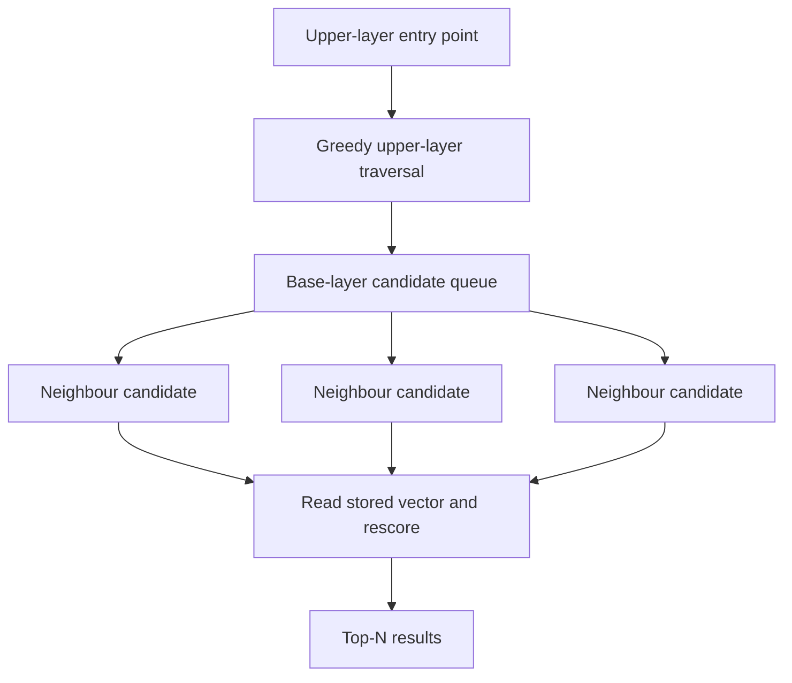

# Vector search

Use this guide when your application already generates compatible embeddings. LeanCorpus stores and searches vectors, but does not choose an embedding model or generate embeddings from document text.

Float32 vector fields are stored per segment with an HNSW graph built at flush time. Searches use HNSW when present, then rerank the shortlist with cosine similarity over the stored Float32 vectors. Quantised fields use their decoded representation for approximate rescoring, as described below.



## Index

```csharp
var doc = new LeanDocument();
doc.Add(new StringField("id", "v1"));
doc.Add(new VectorField("embedding", new float[] { 0.1f, 0.2f, 0.3f, 0.4f }));
writer.AddDocument(doc);
```

All vectors in the same field must have the same dimensionality. Vectors are normalised at index time by default (keeps cosine search cheap). Keep the embedding model, normalisation policy and dimension under application control. Reindex the field when any of those change.

## Query

```csharp
var query = new VectorQuery(
    "embedding",
    queryVector,
    topK: 10,
    efSearch: 128,
    oversamplingFactor: 2);

var hits = searcher.Search(query, topN: 10);
```

For Float32 fields, score is cosine similarity in `[-1, 1]` (typically `[0, 1]` for normalised vectors). Quantised-field scores are estimates from the stored representation and can differ from cosine over the original Float32 embedding.

For HNSW, the effective candidate pool is at least `topK * oversamplingFactor`, even when an explicit `efSearch` is smaller. LeanCorpus then reranks that shortlist using the stored vector representation.

## Build settings

```csharp
var config = new IndexWriterConfig
{
    NormaliseVectors = true,
    BuildHnswOnFlush = true,
    HnswBuildConfig = new HnswBuildConfig
    {
        M = 16,
        EfConstruction = 100,
    },
};
```

Set `HnswSeed` for reproducible graph builds.

## Hybrid retrieval

Combine vector with text via RRF:

```csharp
var rrf = new RrfQuery()
    .Add(new TermQuery("body", "machine learning"))
    .Add(new VectorQuery("embedding", queryVector, topK: 50));
```

Or add a filter directly:

```csharp
var filter = new TermQuery("category", "docs");
var query = new VectorQuery("embedding", queryVector, topK: 10, filter: filter);
```

Apply the filter for tenant, category or permission boundaries rather than filtering results after retrieval. The filter participates in candidate selection and preserves the scope of the search.

## Fallback

If no HNSW graph exists, falls back to a flat SIMD scan. Vector readers are opened lazily, so non-vector searches don't pay the mmap cost.

## Quantisation

New BBQ indexes in 4.0 use a v3 `.vq` format. BBQ v3 is supported for normalised cosine vectors with at least 128 dimensions; the writer rejects smaller dimensions and `NormaliseVectors = false`. It uses one-bit Optimised Scalar Quantisation (OSQ) document codes with prepared 4-bit query codes for HNSW traversal, plus a per-vector canonical unsigned Int8 representation for approximate cosine reranking. The final scores are approximate to the original Float32 vectors.

The one-bit graph codes are only one part of this format. The index also stores canonical Int8 values, correction and per-vector metadata, presence information, and shared segment data. Do not read the one-bit working set as a 32× reduction in total index size. Measure the full index and recall on the target corpus.

```csharp
var config = new IndexWriterConfig
{
    BuildHnswOnFlush = true,
    VectorQuantisation = VectorQuantisation.BBQ,
};
```

Int8 scalar quantisation is also available, compressing 4× with a per-vector min/max scale:

```csharp
var config = new IndexWriterConfig
{
    VectorQuantisation = VectorQuantisation.Int8,
};
```

For BBQ v3, an omitted `oversamplingFactor` selects a three-times HNSW shortlist. Explicit values, including `1`, are honoured. Callers compiled against an earlier optional-parameter default may still pass `1` and keep the one-times shortlist. Int8 stores one byte per component, while BBQ v3 combines one-bit traversal codes with canonical Int8 values; neither representation promises Float32-exact scores. Recall and index size depend on the corpus and dimension, so measure them before choosing a quantisation mode or search budget.

**Qualification status:** ADR042 remains Proposed. The fixed 128D integration recall gate is currently below its declared floor, so BBQ v3 has not completed release qualification. See [ADR042](../articles/ADRs/ADR042-bbq-v3-osq-canonical-int8.md) before treating this branch's BBQ v3 implementation as release-qualified.

Legacy BBQ v1/v2 indexes remain readable and can be structurally migrated while retaining their legacy scoring. That migration cannot recover the original component magnitudes or create BBQ v3 canonical vectors. To move to BBQ v3, rebuild the index from the original embeddings; the 4.0 writer rejects mutation or import of a legacy BBQ index.

## See also

- [Filtered vector search](08-filtered-vector-search.md)
- [Reciprocal rank fusion](04-rrf.md)
- <xref:Rowles.LeanCorpus.Search.Queries.VectorQuery>
