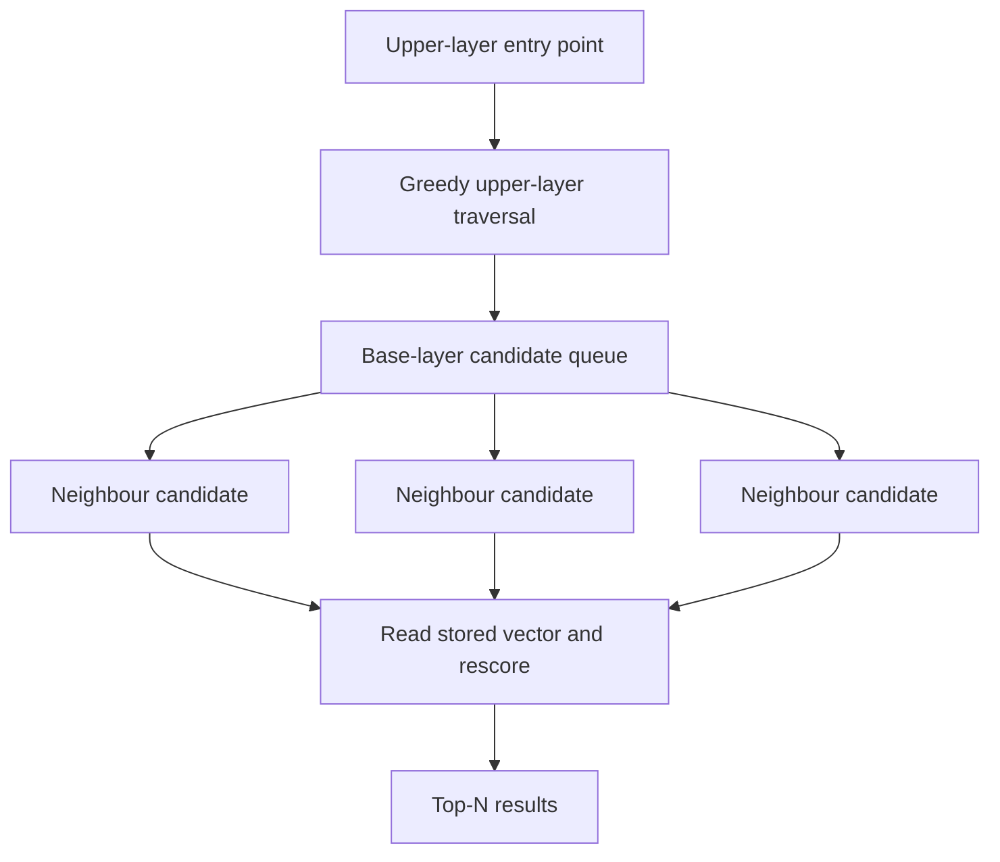

# Vector search

Use this guide when your application already generates compatible embeddings. LeanCorpus stores and searches vectors, but does not choose an embedding model or generate embeddings from document text.

Float32 vector fields are stored per segment with an HNSW graph built at flush time. Searches use HNSW when present, then rerank the shortlist with cosine similarity over the stored Float32 vectors. Int8 and historical BBQ fields use their stored, decoded representation for approximate rescoring, as described below.



## Index

```csharp
var doc = new LeanDocument();
doc.Add(new StringField("id", "v1"));
doc.Add(new VectorField("embedding", new float[] { 0.1f, 0.2f, 0.3f, 0.4f }));
writer.AddDocument(doc);
```

All vectors in the same field must have the same dimensionality. Vectors are normalised at index time by default (keeps cosine search cheap). Keep the embedding model, normalisation policy and dimension under application control. Reindex the field when any of those change.

## Query

```csharp
var query = new VectorQuery(
    "embedding",
    queryVector,
    topK: 10,
    efSearch: 128,
    oversamplingFactor: 2);

var hits = searcher.Search(query, topN: 10);
```

For Float32 fields, score is cosine similarity in `[-1, 1]` (typically `[0, 1]` for normalised vectors). Quantised-field scores are estimates from the stored representation and can differ from cosine over the original Float32 embedding.

For HNSW, the effective candidate pool is at least `topK * oversamplingFactor`, even when an explicit `efSearch` is smaller. LeanCorpus then reranks that shortlist using the stored vector representation.

## Build settings

```csharp
var config = new IndexWriterConfig
{
    NormaliseVectors = true,
    BuildHnswOnFlush = true,
    HnswBuildConfig = new HnswBuildConfig
    {
        M = 16,
        EfConstruction = 100,
    },
};
```

Set `HnswSeed` for reproducible graph builds.

## Hybrid retrieval

Combine vector with text via RRF:

```csharp
var rrf = new RrfQuery()
    .Add(new TermQuery("body", "machine learning"))
    .Add(new VectorQuery("embedding", queryVector, topK: 50));
```

Or add a filter directly:

```csharp
var filter = new TermQuery("category", "docs");
var query = new VectorQuery("embedding", queryVector, topK: 10, filter: filter);
```

Apply the filter for tenant, category or permission boundaries rather than filtering results after retrieval. The filter participates in candidate selection and preserves the scope of the search.

## Fallback

If no HNSW graph exists, falls back to a flat SIMD scan. Vector readers are opened lazily, so non-vector searches don't pay the mmap cost.

## Quantisation

New vector indexes use Float32 by default. Int8 scalar quantisation is also
available, storing one byte per component with per-vector scaling. Its scores
use the decoded Int8 representation and are approximate to the original
Float32 vectors:

```csharp
var config = new IndexWriterConfig
{
    BuildHnswOnFlush = true,
    VectorQuantisation = VectorQuantisation.Int8,
};
```

### Historical BBQ indexes

LeanCorpus 4.0 does not create BBQ indexes. The `VectorQuantisation.BBQ`
identifier is retained for format compatibility, but requesting it for new
output is rejected. Existing sign-BBQ and experimental OSQ `.vq` data remains
readable and searchable with its historical scorer.

Any committed BBQ field makes its whole index read-only, including mixed
indexes and indexes where all BBQ documents have been deleted. Opening a writer,
mutating, importing, merging or migrating such an index is rejected before
persistent changes. A no-op migration is rejected as well. This policy prevents
an older BBQ representation from being silently rewritten or upgraded.

To continue indexing, create a separate Float32 or Int8 index from the original
documents and embeddings. Decoding BBQ values does not recover the original
component magnitudes. Historical BBQ scores are approximate to those originals.
For historical OSQ fields, an omitted `oversamplingFactor` selects the existing
three-times HNSW shortlist; explicit values remain honoured. This is query
compatibility for old indexes, not a BBQ creation path.

ADR042 remains Proposed while mandatory Float32 and Int8 quality gates are
unfinished. See [ADR042](../articles/ADRs/ADR042-bbq-v3-osq-canonical-int8.md)
for the current lifecycle decision and qualification status.

## See also

- [Filtered vector search](08-filtered-vector-search.md)
- [Reciprocal rank fusion](04-rrf.md)
- <xref:Rowles.LeanCorpus.Search.Queries.VectorQuery>
