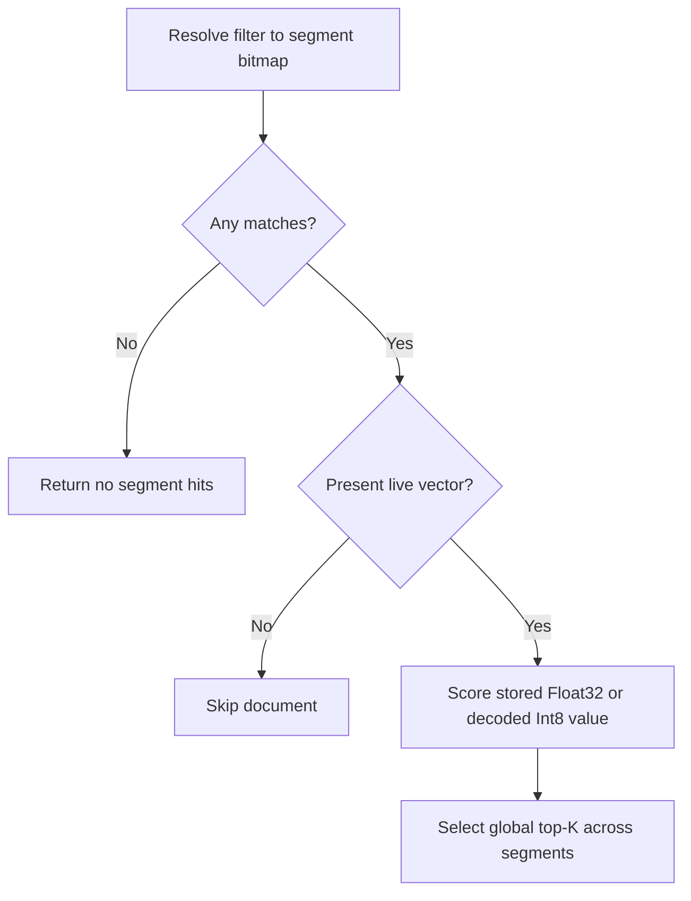

# Filtered vector search

`VectorQuery` accepts a filter for tenant, category, visibility, date, or
another document constraint. LeanCorpus resolves the filter per segment and
scores only matching live documents that have a vector.

```csharp
var filter = new BooleanQuery.Builder()
    .Add(new TermQuery("tenant", tenantId), Occur.Must)
    .Add(new TermQuery("status", "published"), Occur.Must)
    .Build();

var query = new VectorQuery(
    field: "embedding",
    queryVector: embedding,
    topK: 20,
    filter: filter);

var hits = searcher.Search(query, topN: 20);
```

## Float32 and historical Int8 strategy

Float32 fields without a vector graph, and historical Int8 values, use an exact
scan. The filter is applied before vector scoring, so unmatched documents are
not scored. If a matching segment contains an old `.hnsw` graph, that graph is
ignored and the scan is reported as intentional exact work.

When a segment has an opt-in Float32 vector graph (`BuildHnswOnFlush`), the
traversal accepts only documents that pass the filter, and its candidates are
rescored exactly. A selective filter skips the graph: when it leaves fewer than
`max(64, 0.5% of MaxDoc)` documents, or no more than `topK *
oversamplingFactor`, the segment scans those documents exactly and records the
`ExactSelectiveFilter` route. A filter that matches nothing records the same
route. See [Optional vector graph](05-vector-search.md#optional-vector-graph)
for the other fallbacks.



## Filter or Boolean clause

The filter runs before selection, so the query returns up to `topK` matching
documents. Placing the same constraint in a sibling Boolean clause instead
filters the `topK` already selected from all documents, and does not refill
it. Use `filter:` when you want up to `topK` documents that all satisfy the
constraint. A filter cannot contain `RrfQuery` or `MoreLikeThisQuery`;
those throw `NotSupportedException`.

The scan cost depends on the matching document count and vector dimension.
For large result sets, measure the workload with realistic filters and corpus
sizes.

## Historical BBQ strategy

BBQ indexes retain their existing read and query behaviour, including the
historical graph route and its stored-representation scorer. BBQ-containing
indexes remain read-only to writers. New BBQ writes and migrations are not
supported.

`efSearch` and `oversamplingFactor` apply to that historical BBQ graph route
and to the Float32 vector graph. They do not affect exact scans, including
scans over decoded historical Int8 values. `Explain(VectorQuery, docId)` reports the selected strategy, and
search metrics record the route each segment took and separate intentional
exact scans from graph fallbacks.

See [Vector search](05-vector-search.md), [Score explanations](../searching/11-score-explanations.md),
and [Reciprocal rank fusion](04-rrf.md).
