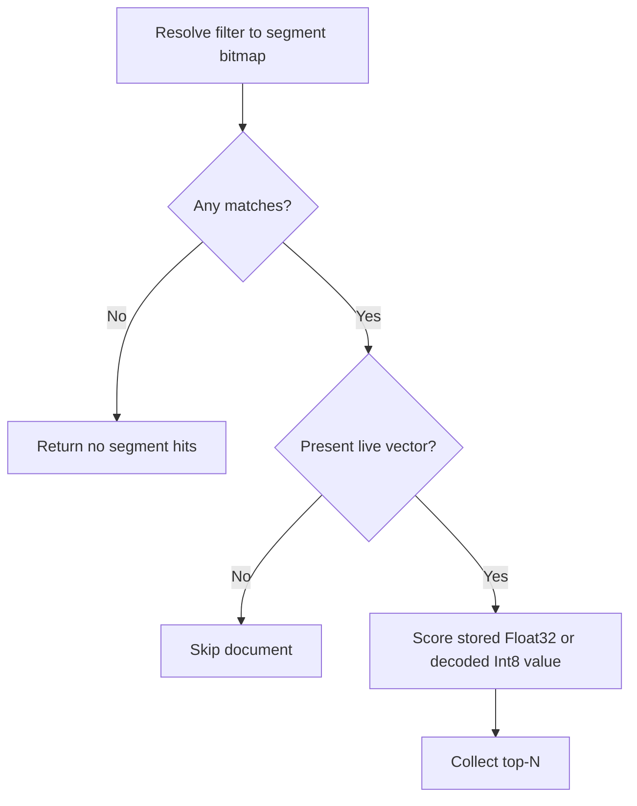

# Filtered vector search

`VectorQuery` accepts a filter for tenant, category, visibility, date, or
another document constraint. LeanCorpus resolves the filter per segment and
scores only matching live documents that have a vector.

```csharp
var filter = new BooleanQuery.Builder()
    .Add(new TermQuery("tenant", tenantId), Occur.Must)
    .Add(new TermQuery("status", "published"), Occur.Must)
    .Build();

var query = new VectorQuery(
    field: "embedding",
    queryVector: embedding,
    topK: 20,
    filter: filter);

var hits = searcher.Search(query, topN: 20);
```

## Current Float32 and historical Int8 strategy

New Float32 indexes and historical Int8 indexes use an exact scan. The filter
is applied before vector scoring, so unmatched documents are not scored. If a
matching segment contains an old HNSW graph, that graph is ignored and the scan
is reported as intentional exact work.



The scan cost depends on the matching document count and vector dimension.
For large result sets, measure the workload with realistic filters and corpus
sizes.

## Historical BBQ strategy

BBQ indexes retain their existing read and query behaviour, including the
historical graph route and its stored-representation scorer. BBQ-containing
indexes remain read-only to writers. New BBQ writes and migrations are not
supported.

`efSearch` and `oversamplingFactor` apply to that historical BBQ graph route.
They do not affect Float32 exact scans or exact scans over decoded historical
Int8 values. `Explain(VectorQuery, docId)` reports the selected strategy, and
search metrics separate intentional exact scans from historical HNSW underfill
fallbacks.

See [Vector search](05-vector-search.md), [Score explanations](../searching/11-score-explanations.md),
and [Reciprocal rank fusion](04-rrf.md).
