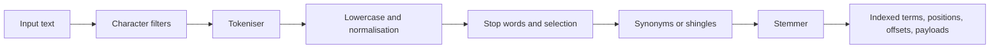

# Analysers

An analyser is the top-level pipeline: tokenise, normalise, filter, output terms.



The exact order is configured by the analyser. Changing it changes indexed terms and normally requires reindexing existing content.

## Built-in analysers

| Type | Pipeline | When |
|---|---|---|
| `StandardAnalyser` | Basic tokenise, lowercase, stop words | General-purpose text |
| `StemmedAnalyser` | `StandardAnalyser` + Porter2 (`EnglishStemmer`) | English text, broader recall |
| `LanguageAnalyser` | Tokenise, lowercase, stop words, optional stemmer | Language-specific with custom tokeniser/stemmer |
| `IcuAnalyser` | `IcuTokeniser`, lowercase, stop words, optional Thai | Unicode-heavy text |
| `WhitespaceAnalyser` | `WhitespaceTokeniser` only | Punctuation and case should stay |
| `KeywordAnalyser` | `KeywordTokeniser` only | Whole field as one token |
| `SimpleAnalyser` | Letter-only tokenise, lowercase | Ignore digits and punctuation |
| `Analyser` | Your tokeniser and filters | Custom pipeline |

An analyser may also implement `ITermNormaliser` for wildcard and range query
literals. This separate contract returns one term without stop-word removal or
token-graph expansion. `StandardAnalyser` lowercases one token even when that
token is a stop word; its regular `Analyse` pipeline continues to remove stop
words.

## Three starting points

```csharp
using Rowles.LeanCorpus.Analysis;

var standard = new StandardAnalyser();
var stemmed  = new StemmedAnalyser();
var french   = AnalyserFactory.Create("fr");
```

## AnalyserFactory languages

`AnalyserFactory.Create(string)` accepts BCP 47 codes. Region and script subtags are stripped (`en-GB` becomes `en`).

Every pipeline tokenises, lowercases and removes the language's stop words, then applies the stemmer below.

<!-- analysis-languages:start -->
| Code | Tokeniser | Default stemmer | Default analysis identity |
|---|---|---|---|
| `en` | `Tokeniser` | `EnglishStemmer` (Snowball 3.2.0 Porter2) | `rowles-analysis/en/3.2.0` |
| `fr` | `Tokeniser` | `FrenchStemmer` (Snowball 3.2.0) | `rowles-analysis/fr/3.2.0` |
| `de` | `Tokeniser` | `GermanStemmer` (Snowball 3.2.0) | `rowles-analysis/de/3.2.0` |
| `es` | `Tokeniser` | `SpanishStemmer` (Snowball 3.2.0) | `rowles-analysis/es/3.2.0` |
| `it` | `Tokeniser` | `ItalianStemmer` (Snowball 3.2.0) | `rowles-analysis/it/3.2.0` |
| `pt` | `Tokeniser` | `PortugueseStemmer` (Snowball 3.2.0) | `rowles-analysis/pt/3.2.0` |
| `nl` | `Tokeniser` | `DutchStemmer` (Snowball 3.2.0) | `rowles-analysis/nl/3.2.0` |
| `ru` | `Tokeniser` | `RussianStemmer` (Snowball 3.2.0) | `rowles-analysis/ru/3.2.0` |
| `ar` | `Tokeniser` | `ArabicStemmer` (Snowball 3.2.0) | `rowles-analysis/ar/3.2.0` |
| `sk` | `Tokeniser` | `SlovakStemmer` | `rowles-analysis/sk/0.2.0` |
| `zh` | `ChineseLexiconTokeniser` | None | `rowles-analysis/zh/0.3.0` |
| `ja` | `JapaneseTokeniser` | None | `rowles-analysis/ja/0.3.0` |
| `ko` | `CJKBigramTokeniser` | None | `rowles-analysis/ko/0.3.0` |
<!-- analysis-languages:end -->

Chinese uses lexicon-based longest-match segmentation, Japanese uses
dictionary-backed Viterbi segmentation, and Korean keeps Hangul word runs
intact. For Arabic, upstream hamza normalisation is recommended.

### Changing or disabling the stemmer

`AnalyserFactory.Create(string, ISpanStemmer?)` keeps the language's tokeniser and stop words and
replaces the stemmer. Pass `null` for no stemming:

```csharp
var exact   = AnalyserFactory.Create("de", stemmer: null);        // German stop words, no stemming
var custom  = AnalyserFactory.Create("de", new MyGermanStemmer()); // your stemmer
```

A custom stemmer must implement `IShareableSpanStemmer` (safe to share) or
`IThreadLocalSpanStemmer` (cloned per owner). Any other stemmer makes analysis throw
`InvalidOperationException`, as with `LanguageAnalyser`.

### Analysis identities and reindexing

`AnalyserFactory.GetDefaultAnalysisId(code)` returns an identity such as `rowles-analysis/de/3.2.0`
for the `Create(code)` pipeline. It changes exactly when that pipeline's output can change.
Snowball languages carry the Snowball version of their algorithm, with `+rN` for later
LeanCorpus-only changes; other languages carry a LeanCorpus `0.x.y` version.
`StandardAnalyser` (default stop words) and `StemmedAnalyser` (no keyword marker) also carry
identities, `rowles-analysis/standard/...` and `rowles-analysis/stemmed-en/...`.

An analyser reports its identity through `IAnalysisIdentityProvider`, which `AnalysisIdentity.Of`
reads. A pipeline you configure yourself (a custom stemmer, custom stop words, a keyword marker,
or a hand-built `Analyser`) has no identity unless you give it one:

```csharp
var products = AnalysisIdentity.Assign(myAnalyser, "myapp/en-products/1"); // bump when output changes
```

### Index enforcement

An index records the identity of every analysed field in each commit, and `IndexWriter` refuses a
field whose identity would change, with `AnalysisIdentityMismatchException`. A recorded field is
checked when the writer opens; a new field before its first analysis. An analyser without an
identity is recorded as `unidentified`, and so is every field while writer-level character
filters are configured. Changing between two unidentified analysers is not detected, so identify
custom pipelines with `AnalysisIdentity.Assign`.

An index written before 4.0 has no recorded identities, and its analysis matches none of the 4.0
identities, because 4.0 also keeps position gaps where stop words are removed. The writer
therefore refuses to analyse any field into such an index. Reindex from source, or set
`IndexWriterConfig.AcceptAnalysisIdentityChanges` to record the current identities and keep the
existing terms. That setting also accepts a deliberate change on a 4.0 index; existing terms are
not reanalysed either way.

Query analysis happens outside the index. Check a query analyser against the recorded identity
with `IndexAnalysisIdentities.EnsureCompatible(directory, field, analyser)`, or read them all with
`IndexAnalysisIdentities.Read(directory)`.

### Identities before 4.0

Releases before 4.0 reported no identities, and no 4.0 identity describes their output. The
nine Snowball languages had no identity before 4.0. The LeanCorpus-versioned languages number
their earlier output eras, so the 4.0 versions are not `0.1.0`:

| Language | Identity | Engine releases | Rowles.Text | What defines it |
| --- | --- | --- | --- | --- |
| `zh`, `ja`, `ko` | `0.3.0` | 4.0 | 2.0.0 | Stop-word position gaps, whole-token lower-casing, combining marks and supplementary-plane letters, digits and punctuation |
| `zh`, `ja`, `ko` | `0.2.0` | 2.3.0 to 3.1.1 | 1.0.0 | `zh` lexicon tokeniser, `ja` Viterbi segmentation, `ko` no longer bigrams Hangul |
| `zh`, `ja`, `ko` | `0.1.2` | 2.2.0 | | Non-ASCII capitals lower-cased again |
| `zh`, `ja`, `ko` | `0.1.1` | 2.0.0 to 2.1.1 | | Lower-casing only from the first A to Z |
| `zh`, `ja`, `ko` | `0.1.0` | 1.1.1 to 1.4.2 | | CJK bigrams, whole-token invariant lower-casing |
| `sk` | `0.2.0` | 4.0 | 2.0.0 | The 4.0 pipeline changes above, and the stemmer rework: hard final consonants, long vowels, inserted `ie`, adjective degree, infinitives, irregular nouns, `-omat` nouns, no foreign-word `-i` rewrite, syllabic `ĺ`, and no crash on suffix-only tokens |
| `sk` | `0.1.0` | 2.2.0 to 3.1.1 | 1.0.0 | Added in 2.2.0 |

The earlier eras were traced from the source history. They are listed to explain the 4.0
numbers; an index built by those releases records no identity, so 4.0 treats it as unknown.

LeanCorpus 4.0 replaced the earlier Snowball-style suffix tables with the official algorithms, so
fields analysed by an earlier release with `en`, `fr`, `de`, `es`, `it`, `pt`, `nl`, `ru` or `ar`
(and `StemmedAnalyser`) need reindexing. The German stop-word list also gained `ans`, `aufs`,
`ins` and `vom`. Slovak (`sk`) fields need reindexing too: the 4.0 Slovak stemmer writes every
stem with a hard final consonant and joins more forms of one word, so `mesto` and `meste`, `kosť`
and `kosti`, `štát` and `štátu`, or `nový` and `najnovší`, now share a term.

## Per-field override

Set the default on `IndexWriterConfig.DefaultAnalyser`. Override per-field by attaching an `IAnalyser` to a `FieldMapping` inside an `IndexSchema`.

## Inspect tokens

```csharp
foreach (var token in standard.Analyse("The Quick Brown Foxes".AsSpan()))
    Console.WriteLine(token.Text);
// quick, brown, foxes
```

## See also

- [Analysis overview](index.md)
- [Tokenisers](02-tokenisers.md)
- [Stemmers](04-stemmers.md)
- <xref:Rowles.LeanCorpus.Analysis.Analysers.AnalyserFactory>
