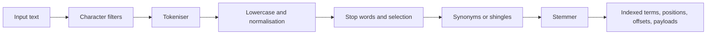

# Analysers

An analyser is the top-level pipeline: tokenise, normalise, filter, output terms.



The exact order is configured by the analyser. Changing it changes indexed terms and normally requires reindexing existing content.

## Built-in analysers

| Type | Pipeline | When |
|---|---|---|
| `StandardAnalyser` | Basic tokenise, lowercase, stop words | General-purpose text |
| `StemmedAnalyser` | `StandardAnalyser` + Porter2 (`EnglishStemmer`) | English text, broader recall |
| `LanguageAnalyser` | Tokenise, lowercase, stop words, optional stemmer | Language-specific with custom tokeniser/stemmer |
| `IcuAnalyser` | `IcuTokeniser`, lowercase, stop words, optional Thai | Unicode-heavy text |
| `WhitespaceAnalyser` | `WhitespaceTokeniser` only | Punctuation and case should stay |
| `KeywordAnalyser` | `KeywordTokeniser` only | Whole field as one token |
| `SimpleAnalyser` | Letter-only tokenise, lowercase | Ignore digits and punctuation |
| `Analyser` | Your tokeniser and filters | Custom pipeline |

An analyser may also implement `ITermNormaliser` for wildcard and range query
literals. This separate contract returns one term without stop-word removal or
token-graph expansion. `StandardAnalyser` lowercases one token even when that
token is a stop word; its regular `Analyse` pipeline continues to remove stop
words.

## Three starting points

```csharp
using Rowles.LeanCorpus.Analysis;

var standard = new StandardAnalyser();
var stemmed  = new StemmedAnalyser();
var french   = AnalyserFactory.Create("fr");
```

## AnalyserFactory languages

`AnalyserFactory.Create(string)` accepts BCP 47 codes. Region and script subtags are stripped (`en-GB` becomes `en`).

Every pipeline tokenises, lowercases and removes the language's stop words, then applies the stemmer below.

<!-- analysis-languages:start -->
| Code | Tokeniser | Default stemmer | Default analysis identity |
|---|---|---|---|
| `en` | `Tokeniser` | `EnglishStemmer` (Snowball 3.2.0 Porter2) | `rowles-analysis/en/3.2.0` |
| `fr` | `Tokeniser` | `FrenchStemmer` (Snowball 3.2.0) | `rowles-analysis/fr/3.2.0` |
| `de` | `Tokeniser` | `GermanStemmer` (Snowball 3.2.0) | `rowles-analysis/de/3.2.0` |
| `es` | `Tokeniser` | `SpanishStemmer` (Snowball 3.2.0) | `rowles-analysis/es/3.2.0` |
| `it` | `Tokeniser` | `ItalianStemmer` (Snowball 3.2.0) | `rowles-analysis/it/3.2.0` |
| `pt` | `Tokeniser` | `PortugueseStemmer` (Snowball 3.2.0) | `rowles-analysis/pt/3.2.0` |
| `nl` | `Tokeniser` | `DutchStemmer` (Snowball 3.2.0) | `rowles-analysis/nl/3.2.0` |
| `ru` | `Tokeniser` | `RussianStemmer` (Snowball 3.2.0) | `rowles-analysis/ru/3.2.0` |
| `ar` | `Tokeniser` | `ArabicStemmer` (Snowball 3.2.0) | `rowles-analysis/ar/3.2.0` |
| `sk` | `Tokeniser` | `SlovakStemmer` | `rowles-analysis/sk/0.1.0` |
| `zh` | `ChineseLexiconTokeniser` | None | `rowles-analysis/zh/0.1.0` |
| `ja` | `JapaneseTokeniser` | None | `rowles-analysis/ja/0.1.0` |
| `ko` | `CJKBigramTokeniser` | None | `rowles-analysis/ko/0.1.0` |
<!-- analysis-languages:end -->

Chinese uses lexicon-based longest-match segmentation, Japanese uses
dictionary-backed Viterbi segmentation, and Korean keeps Hangul word runs
intact. For Arabic, upstream hamza normalisation is recommended.

### Changing or disabling the stemmer

`AnalyserFactory.Create(string, ISpanStemmer?)` keeps the language's tokeniser and stop words and
replaces the stemmer. Pass `null` for no stemming:

```csharp
var exact   = AnalyserFactory.Create("de", stemmer: null);        // German stop words, no stemming
var custom  = AnalyserFactory.Create("de", new MyGermanStemmer()); // your stemmer
```

A custom stemmer must implement `IShareableSpanStemmer` (safe to share) or
`IThreadLocalSpanStemmer` (cloned per owner). Any other stemmer makes analysis throw
`InvalidOperationException`, as with `LanguageAnalyser`.

### Analysis identities and reindexing

`AnalyserFactory.GetDefaultAnalysisId(code)` returns an identity such as `rowles-analysis/de/3.2.0`
for the `Create(code)` pipeline. It changes exactly when that pipeline's output can change, so
store it with your index and reindex the affected fields when it differs. Snowball languages carry
the Snowball version of their algorithm, with `+rN` for later LeanCorpus-only changes; other
languages carry a LeanCorpus version. Releases before 4.0 had no identity; their output
corresponds to `0.1.0` for every language. A pipeline with a custom stemmer has no built-in
identity.

LeanCorpus 4.0 replaced the earlier Snowball-style suffix tables with the official algorithms, so
fields analysed by an earlier release with `en`, `fr`, `de`, `es`, `it`, `pt`, `nl`, `ru` or `ar`
(and `StemmedAnalyser`) need reindexing. The German stop-word list also gained `ans`, `aufs`,
`ins` and `vom`.

## Per-field override

Set the default on `IndexWriterConfig.DefaultAnalyser`. Override per-field by attaching an `IAnalyser` to a `FieldMapping` inside an `IndexSchema`.

## Inspect tokens

```csharp
foreach (var token in standard.Analyse("The Quick Brown Foxes".AsSpan()))
    Console.WriteLine(token.Text);
// quick, brown, foxes
```

## See also

- [Analysis overview](index.md)
- [Tokenisers](02-tokenisers.md)
- [Stemmers](04-stemmers.md)
- <xref:Rowles.LeanCorpus.Analysis.Analysers.AnalyserFactory>
