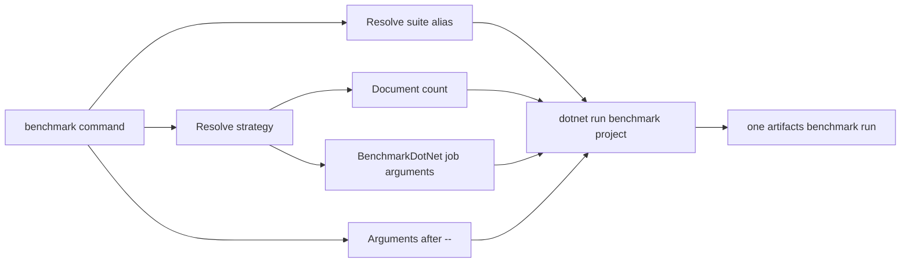

# DevOps entry point

Run `pwsh -NoProfile -File ./devops.ps1 bootstrap` after cloning or when the
managed host is missing or stale. This explicit command restores the pinned
repository tools, restores and builds the managed DevOps test-project graph,
independently verifies the host's multi-RID lock, runs the compiled test
apphost, then publishes and validates a current-RID single-file executable at
the repository root. Bootstrap builds the DevOps test project graph directly,
so the host is ready without first building the full product solution. Normal
commands never restore, build or test implicitly. The complete project
inventory is `src/Rowles.LeanCorpus.slnx`; focused build entry points are under
`src/solutions/`.

On Linux and macOS, `./devops` is that generated managed apphost. On Windows,
use `./devops.exe`. Every supported command runs through the managed host.
`devops.ps1` is the maintained PowerShell entry point: it checks the host
fingerprint and forwards arguments without importing the retired PowerShell
command application. `bootstrap` is its sole reserved verb. Workflows call the
managed host directly after bootstrap. A missing or stale managed host refuses
dispatch and prints the bootstrap command; a managed command failure never
falls back to PowerShell. The apphost supports documentation, local/affected
and SSH/tmux benchmark runs, DataForge
generation/reference commands and qualification, diagnostics, reporting,
packaging and distribution.

## Why it exists

The entry point centralises:

- project and framework selection;
- suite and strategy aliases;
- benchmark project paths, execution policy and documentation labels;
- generated-output locations;
- benchmark provenance;
- documentation metadata and report generation;
- tool discovery;
- consistent failure handling across local use and CI.

Callers should not need to reproduce long `dotnet` command lines or know which generated directories must be prepared first.

## Command map

| Command | Purpose | Typical example |
|---|---|---|
| `build` | Managed: restore and build the supported solution targets | `./devops build` |
| `test` | Managed: run registered suites with linked test evidence | `./devops test architecture --framework net10.0 --count 2` |
| `aot` | Managed: publish and run Native AOT smoke tests; release qualification remains open | `./devops aot --framework net10.0` |
| `coverage` | Managed apphost: run coverage-eligible suites and optionally generate a pinned HTML report | `./devops coverage -Suite sourcegen -GenerateReport` |
| `benchmark` | Managed apphost: local and affected BenchmarkDotNet suites plus remote SSH/tmux lifecycle | `./devops benchmark --list` |
| `config` | Print a bounded checkout and configuration summary; `config validate` checks metadata, while `--deep` compares built benchmark host manifests and `--solution-inventory` checks tracked projects and filters | `./devops config`; `./devops config validate --solution-inventory` |
| `diagnostics` | Managed apphost: list processes and capture .NET diagnostics with run evidence | `./devops diagnostics capture --pid 1234 --duration 5s` |
| `corpus` | Prepare managed benchmark datasets | `./devops corpus gutenberg --book-count 200` |
| `fixtures` | List or generate pinned historical fixtures | `./devops fixtures list`; `./devops fixtures generate --version 3.1.1 --scenario migration` |
| `data` | Deprecated compatibility routes for corpus and historical fixture workflows | `./devops data gutenberg --book-count 200`; `./devops data fixtures --list` |
| `dataforge` | Managed apphost: run DataForge generation, reference and qualification commands; `--help` resolves locally without launching the tool | `./devops dataforge --help`; `./devops dataforge qualify` |
| `docs` | Managed: prepare inputs, generate API metadata, build, validate or serve DocFX | `./devops docs build --skip-benchmarks` |
| `server start` | Managed: start the Community Server in the foreground on loopback, or use `-External` for trusted-network access | `./devops server start -External` |
| `clean` | Managed: remove selected DevOps-owned output | `./devops clean test` |
| `pack` | Managed apphost: build release packages, validate APIs and archives, or run isolated package consumers | `./devops pack --clean --validate-packages` |
| `distribute` | Managed apphost: publish one single-file DevOps executable and package its source manifest, notices and checksums | `./devops distribute --rid linux-x64` |
| `report` | Managed: report repository history, tracked files or code health; `--json` writes a versioned evidence envelope | `./devops report git --json` |
| `ui` | Managed apphost: open the interactive Spectre.Console workbench | `./devops ui` |

Use `pwsh -NoProfile -File ./devops.ps1 bootstrap` to restore tools and publish
the managed host. There is no `devops setup` command.

The optional workbench is included in the managed apphost. Its build and
quality menus cover clean, build, pack, distribute, tests, coverage, AOT and
repository reports. Benchmark choices cover configured suites, sustained
workloads, remote runs, qualification summaries and the registered catalogue.
DataForge choices cover profile discovery, generation, Wikipedia reference
operations, and generated-dataset inspection, verification and reproduction.
Separate menus cover fixtures, corpora, documentation, server diagnostics,
configuration and recent runs. Selecting a command sends argument tokens
through the same managed parser and handlers used by the CLI. The home screen
loads only version and checkout information; repository, SDK and run metadata
are read when their corresponding views are selected.

## Optional .NET tool package

The DevOps project also has a framework-dependent .NET 10 tool profile for
installations that need the `devops` command outside the repository apphost.
Build the package locally with:

```bash
dotnet pack src/devops/tooling/Rowles.LeanCorpus.DevOps/Rowles.LeanCorpus.DevOps.csproj \
  --configuration Release \
  --output artifacts/devops/distribution/tool \
  -p:DevOpsDistributionProfile=Tool \
  -p:RestoreLockedMode=true
```

The profile creates `Rowles.LeanCorpus.DevOps` version `1.0.0`, with command
name `devops`. It requires a .NET 10 runtime and does not bundle the SDK, Git,
repository-pinned tools or Native AOT toolchains. The package is intended to be
run from a compatible LeanCorpus checkout. Its dependency graph is locked in
`packages.tool.lock.json`, separately from the repository host. This build
produces a local package; publishing it to a feed is a separate release action.

## Release archives

`distribute` creates one ZIP archive for a qualified release target and records
the publish and archive runs under `artifacts/build/runs/` and
`artifacts/distribution/runs/`. The archive contains the single-file
executable, source and version manifest, runtime prerequisites, project
licence, third-party notices and payload checksums. A `.sha256` sidecar
verifies the archive itself. Use `--self-contained` to include the .NET runtime;
Git and the SDK selected by the target checkout's `global.json` are still
required for repository operations. Current command examples:

```bash
./devops distribute --rid linux-x64
./devops distribute --rid win-x64 --self-contained
```

The release archive profile uses `packages.distribution.lock.json`; its
RID-specific publish dependencies do not alter the repository-host or tool
profile lock files.

The package ID and version remain provisional until availability is checked
before a separately authorised publication.

Managed reports accept `all`, `git`, `files` or `code`; use `--top`, `--path`,
`--strict` and `--json` to select the view and output contract. Each run is
stored under `artifacts/report/runs/` with its versioned report, child-process
logs and manifest. JSON warnings identify shallow history, approximate Git
rename attribution and the limits of syntax-based code checks.
NUL-safe Git parsing preserves churn and touch history across similarity-detected
renames that the legacy text parser dropped; equal-ranked rows now use stable
ordinal ordering.

The code dependency graph evaluates every tracked `*.csproj`, including projects
outside `src/Rowles.LeanCorpus.slnx`, together with any solution-only entries.
`ProjectCount` reports that union; `SolutionProjectCount` and
`TrackedProjectCount` show the two inventories separately. Package totals come
from SDK-evaluated metadata, including implicit package references, so they can
differ from the legacy report's raw project-file scan.

Use `benchmark` for running measurements. `docs build` prepares and publishes
the benchmark pages from retained run artefacts as part of the documentation
site build.

`./devops dataforge qualify` verifies the frozen Wikipedia reference, runs the
DataForge and related test suites, checks synthetic benchmark identities, and
runs the Wikipedia smoke and default benchmark suites. It records each child
run and validates every Wikipedia report against the verified reference
identity. This is qualification evidence, not a performance comparison. Generation and reference commands use the same managed route and retain their
DataForge tool arguments.

Coverage selects suites marked eligible in the managed test registry. `all`
skips ineligible suites, and tests marked `Coverage=Skip` remain excluded unless
`-IncludePerformance` is supplied. Failed, cancelled or timed-out tests retain raw Cobertura files and their
original outcome; HTML generation only follows successful tests. Raw files and
optional HTML output are retained under `artifacts/coverage/runs/`; `-GenerateReport` uses the pinned
repository-local ReportGenerator tool.

## Argument handling

The managed CLI combines two styles:

- command or subcommand tokens such as `docs serve`, `server start` and `dataforge reference download`;
- PowerShell-style named options such as `-Suite query`, `-Framework net10.0`, and `-SkipBenchmarks`.

BenchmarkDotNet arguments follow a `--` separator:

```powershell
./devops benchmark --suite query --strat quick-compare -- --filter "*TermQuery*"
```

Keep repository arguments before `--`. Everything after it is passed to the benchmark process.

## Test suites

`.config/devops/test-suites.json` is the canonical alias map. It maps short names to project paths or, for Native AOT, to the dedicated command route. Browser-required suites `server-orchard-functional` and `docs-site` are explicit-only and do not run under `test all`; `server-orchard` remains in the generic selection. Server suites default to `net11.0`; their project and registry metadata currently also declare `net10.0`.

The Playwright package version is centrally pinned in `Directory.Packages.props` (currently 1.63.0). Build the browser test project and install Chromium using its generated script. The managed test executor automatically checks the central pin against the selected output's `.deps.json`, verifies the Chromium executable and launches it headlessly before running a browser-required target. For Linux Orchard tests:

```bash
./devops build --project src/server/devops/Rowles.LeanCorpus.OrchardCore.Search.FunctionalTests/Rowles.LeanCorpus.OrchardCore.Search.FunctionalTests.csproj --framework net10.0
pwsh artifacts/bin/Rowles.LeanCorpus.OrchardCore.Search.FunctionalTests/release_net10.0/playwright.ps1 install --with-deps chromium
./devops test server-orchard-functional --ci --framework net10.0
```

On Windows, omit `--with-deps`. `docs-site` uses its own generated script under `artifacts/bin/Rowles.LeanCorpus.Tests.Docs/release_net10.0`; after installing Chromium, run `./devops docs test --framework net10.0 --no-restore`. Affected selection retains matching browser-required suites and marks them with `requiresBrowser` in `selection.json`; route those targets to a browser-capable worker. Neither `test all` nor `test affected` downloads a browser implicitly. `test all` excludes browser-required suites, while `test affected` performs the preflight if it selects one.

When adding a test project:

1. add it to the solution and normal build wiring;
2. add a clear alias to `.config/devops/test-suites.json`;
3. make the default test selection explicit;
4. update CI only when the suite belongs in required validation;
5. update contributor documentation when its role is not obvious.

Do not bypass the central map with a second list in another script.

## Benchmarks

The managed `benchmark` command uses the repository's benchmark suite,
strategy, dataset and group configuration. It accepts `--suite`, `--strat`,
`--framework`, `--dataset`, `--area`, `--group`, `--timeout-minutes`, `--dry`
and `--list`; legacy PowerShell option aliases are accepted by the apphost.
Each strategy configures its aggregate run, build and project-child deadlines.
The `exhaustive` strategy currently allows 1,440 minutes for its aggregate run.
`--timeout-minutes` overrides only that aggregate deadline; non-positive values
and values above 40,000 minutes are rejected. Dry runs show the resolved
budgets, and executed runs retain them in their manifests and reports. Dataset
selection is limited to synthetic and the frozen Wikipedia reference, whose
supported suites and 20,000-document ceiling are checked before execution.
Local BenchmarkDotNet arguments follow `--`. Remote SSH/tmux and affected-source
workflows also use the managed host; release qualification remains separate
from implementation.

`all` excludes explicit-only workloads. The capacity-one async stress case is
available as `async-index-stress` with its own `async-stress` (1,000-document,
30-minute) strategy. The 100,000-document deep case uses
`async-stress-deep`, with a separate 1,440-minute aggregate and project budget.
Both are explicit selections and are recorded as outside the routine `all`
scope.



`--dry` prints the resolved managed command plan. Use it when changing routing
or investigating a local invocation.

```bash
./devops benchmark --suite async-index-stress --strat async-stress --dry
./devops benchmark --suite async-index-stress --strat async-stress-deep --dry
```

The bounded manual benchmark workflow collects run reports and shard exits,
then calls `benchmark qualification-summary`. Pass the expected report count
from the plan, including its smoke run; `--plan-only` writes a schema-v1 summary
without requiring completed runs. The summary records run qualification and
failure reason codes, keeps comparative values unpublished, and exits non-zero
when the expected reports or shard results are incomplete. Each run retains the
schema-v1 nested `execution` object, including `execution.classification`; a
missing or malformed classification fails qualification.

`benchmark affected` reads staged, modified, renamed and untracked paths from
the current checkout, matches the existing benchmark group map, and records
the selected paths and groups with the run. It refuses an empty selection.
Area and group filters narrow that selection; a custom BenchmarkDotNet filter
cannot be combined with class-scoped affected runs.

Start a remote run by naming the host, absolute POSIX checkout path and branch;
arguments after `--` are forwarded as benchmark command tokens:

```bash
./devops benchmark remote start --host jordan@debian --path /home/jordan/code/leancorpus --branch main -- --suite query --strat intense
./devops benchmark remote status --run-id <run-id>
./devops benchmark remote cancel --run-id <run-id>
```

The remote dispatcher requires a clean checkout, fetches and fast-forwards the
requested branch, verifies that its managed apphost is current, then starts a
unique tmux session. Remote run and session identity are stored under the local
benchmark run directory. A lost SSH connection or local cancellation leaves
remote state unknown until a later status response confirms a terminal state.
Cancellation sends Ctrl+C and is not reported as complete before that check.
The legacy `-Remote`, `-RemotePath`, `-Branch`, `-SessionName` and
`-BenchmarkArgs` forms remain accepted during transition; use `--` for exact
argument boundaries.

`--controlled` applies a deterministic diagnostic preset and selects
corpus-only cases. It does not make different hardware or runtime environments
equivalent.

When adding an alias, keep its name short and stable. Point it at an existing benchmark-suite selector rather than adding duplicate benchmark logic.

## Documentation workflow

The `docs` command has `prepare`, `build`, `metadata`, and `serve` paths.

`prepare` recreates `artifacts/docs/content/` from canonical `docs/content/`,
imports repository-owned guides from `docs/site-config/imports.json`, copies
canonical changelog entries, generates ADR and section indexes/TOCs, derives
site metadata, and generates benchmark reports from retained runs.

The `build` and `serve` paths then:

1. generate coverage HTML when current-commit source data exists unless `-SkipCoverage` is set;
2. clear and generate DocFX API metadata under `artifacts/docs/api/`;
3. remove inherited external members from generated API YAML;
4. build the DocFX site under `artifacts/docs/site/`.

`-SkipBenchmarks` creates the benchmark overview without scanning retained
runs. It does not skip conceptual pages or API metadata. `metadata` also stages
the complete content tree before generating API YAML; `prepare` stops before
invoking DocFX.

DocFX warnings are grouped by code in the console. Complete metadata and build
diagnostics are written as JSON lines under `artifacts/docs/diagnostics/`. A
status line is printed every 30 seconds while DocFX is running so a slow API
pass does not appear stuck.

Generated repository copies, API, site, benchmark, and coverage output must remain generated. Change their canonical source or generator instead of patching the output.

## Tool discovery

The documentation workflow uses the repository-pinned DocFX tool restored by
`pwsh -NoProfile -File ./devops.ps1 bootstrap`. Coverage reports use the
repository-pinned ReportGenerator tool restored by the same bootstrap.

The current DocFX tool release bundles its own frontend dependencies. The documentation diagram pipeline separately pins authoring dependencies under `docs/site-config/diagrams` where a version must be controlled by the repository.

## Adding a command

Add a top-level command only when it represents a durable repository workflow. Prefer extending an existing command when the new behaviour shares its inputs and outputs.

A new command should:

- parse arguments before doing work;
- validate aliases and paths with a useful error;
- use existing helper functions and repository scripts;
- return the underlying process exit code;
- avoid changing generated or source directories outside its stated scope;
- implement command behaviour in the managed DevOps host and keep PowerShell entry points limited to bootstrap or argument forwarding;
- have one concise example in contributor documentation;
- remain non-interactive in CI.

Keep repository command behaviour in the managed DevOps services. Use focused
scripts only for standalone platform-independent validation or data-generation
tasks that are not command routes.

## CI contract

`.github/workflows/build.yml` is the required validation contract. The DevOps entry point and CI should use equivalent commands where practical, but local-only diagnostics and expensive repeated benchmarks should remain opt-in unless they are intentionally promoted to merge validation.

CI bootstraps the checked-out DevOps host with `pwsh -NoProfile -File ./devops.ps1 bootstrap` and invokes the root apphost directly for product builds, tests, AOT, diagnostics, `report all`, package archive validation, package consumers and the manual benchmark workflow.

When changing routing, inspect both local callers and workflow callers before removing an option or alias.

## Validate optional compression packages for release

The 4.0 release matrix is LeanCorpus 4.0.0, Rowles.Text 2.0.0 and
LeanCorpus.Compression.LZ4, Snappy and Zstandard 2.0.0. The optional packages
require Core `[4.0.0,5.0.0)` and do not directly depend on Rowles.Text.

```bash
./devops pack -CompressionOnly -ValidateCompression
# After a full solution build, reuse those binaries:
./devops pack -CompressionOnly -NoBuild -ValidateCompression
```

The gate inspects the generated `.nupkg` and `.snupkg` identities, both TFM
dependency groups and an explicit asset allow-list. Symbol packages contain
portable PDBs matching the normal assembly names; source files are not embedded
as separate package content. No build or test artefacts belong in these packages.

One isolated temporary consumer project installs each local optional package in
turn on .NET 10 and .NET 11. Local source mapping supplies Core and the optional
package, with normal configured feeds supplying third-party dependencies. Each
codec registers before index access. Separate processes create/commit and reopen
an index and verify stored fields, codec policy, resolved Core version and
assembly/file versions. An exact Core 3.1.1 pairing must fail NuGet resolution.
The negative probe may restore the historical package from a configured feed.

Review `artifacts/package/release/manifest.json` and the acceptance evidence under
`artifacts/temp/compression-consumer`; the standard test `run.json` records
status and the consumer evidence path. The scoped pack manifest lists only the
current Core and optional packages, preserving older local artefacts separately. Packing and validation do not publish any
package. Run focused compression/registration tests, the architecture suite,
the full build, docs build and `git diff --check` before release.

## Select affected tests

```powershell
./devops test affected
./devops test affected -Commit HEAD
./devops test affected -Commit caf4bd5
./devops test affected -Range HEAD~3..HEAD
```

Plain `affected` selects only modified tracked, staged and untracked non-ignored
files. `-Commit` selects only the chosen commit's changes against its first
parent, or the empty tree for a root commit. Abbreviated SHAs and normal Git
commit-ish values are supported. `-Range` selects only the supplied explicit
Git revision range. Both history modes ignore unrelated dirty state. DevOps
neither infers a branch base nor fetches remote revisions.

`-Commit` and `-Range` are mutually exclusive and valid only with `affected`.
Invalid revisions, unmapped paths and selections producing zero test targets
are hard failures. Selection paths are normalised, de-duplicated and sorted
before the existing code-area mapper runs. The console shows the source,
changed-file count and targets. Runs producing artefacts retain the source,
supplied revision, resolved commit and first parent where applicable, current
HEAD, selected paths and targets in `run.json` under `affectedSelection`.

The managed DevOps test suite covers argument selection and rejects invalid or
empty affected-test selections. The managed bootstrap smoke checks that no
PowerShell command application or `.psd1` configuration has returned, and the
managed CLI contract tests cover command-line argument forwarding.
