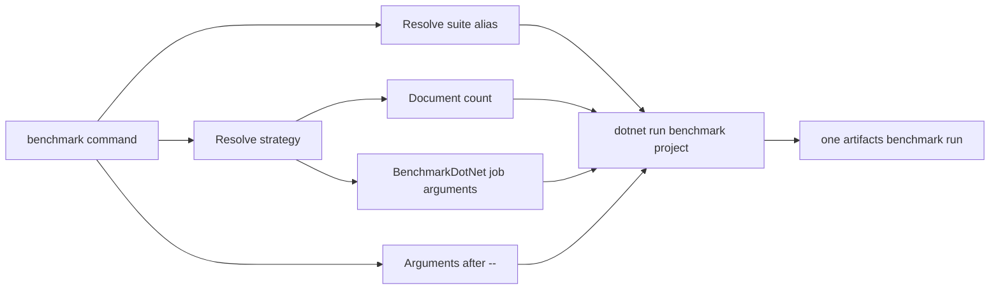

# DevOps entry point

Run `pwsh -NoProfile -File ./setup.ps1` after cloning or when the managed host
needs rebuilding. It restores the pinned repository tools, builds and tests the
dedicated managed DevOps solution, then publishes and validates a current-RID
single-file executable at the repository root.

On Linux and macOS, `./devops` is that generated managed apphost. On Windows,
use `./devops.exe`. `devops.ps1` remains the PowerShell transition dispatcher.
It forwards `build`, `clean`, `report`, `diagnostics`, and `server start` to a
fresh managed host. The apphost also supports local benchmark runs through
`./devops benchmark` and DataForge qualification through
`./devops dataforge qualify`; `pwsh ./devops.ps1 benchmark` remains on the
legacy route while benchmark CI and remote workflows are migrated. Other
commands remain on the legacy PowerShell implementation and must be invoked as
`pwsh ./devops.ps1 <command>`. A missing or stale managed host is a setup
error; the dispatcher does not fall back to the legacy command after a
managed command fails.

## Why it exists

The entry point centralises:

- project and framework selection;
- suite and strategy aliases;
- generated-output locations;
- benchmark provenance;
- documentation metadata and report generation;
- tool discovery;
- consistent failure handling across local use and CI.

Callers should not need to reproduce long `dotnet` command lines or know which generated directories must be prepared first.

## Command map

| Command | Purpose | Typical example |
|---|---|---|
| `build` | Managed: restore and build the supported solution targets | `./devops build` |
| `test` | PowerShell: run one or more registered test suites | `pwsh ./devops.ps1 test` |
| `aot` | PowerShell: publish and run Native AOT smoke validation | `pwsh ./devops.ps1 aot` |
| `coverage` | PowerShell: collect coverage and optionally generate a report | `pwsh ./devops.ps1 coverage` |
| `benchmark` | Managed apphost: list or run local BenchmarkDotNet suites; PowerShell: remote and affected runs | `./devops benchmark --list` |
| `diagnostics` | Managed apphost: list processes and capture .NET diagnostics with run evidence | `./devops diagnostics capture --pid 1234 --duration 5s` |
| `data` | PowerShell: prepare a named benchmark corpus | `pwsh ./devops.ps1 data gutenberg` |
| `dataforge` | Managed apphost: run qualification; PowerShell: manage datasets and reference data | `./devops dataforge qualify` |
| `docs` | PowerShell: prepare staged inputs, generate API metadata and build or serve DocFX | `pwsh ./devops.ps1 docs build -SkipBenchmarks` |
| `server start` | Managed: start the Community Server in the foreground on loopback, or use `-External` for trusted-network access | `./devops server start -External` |
| `benchmarks docs` | PowerShell: regenerate benchmark documentation pages | `pwsh ./devops.ps1 benchmarks docs` |
| `clean` | Managed: remove selected DevOps-owned output | `./devops clean test` |
| `pack` | PowerShell: pack release artefacts and write a checksum manifest | `pwsh ./devops.ps1 pack` |
| `report` | Managed: report repository history, tracked files or code health; `--json` writes a versioned evidence envelope | `./devops report git --json` |
| `setup` | PowerShell: inspect the development environment and optional UI dependency | `pwsh ./devops.ps1 setup` |
| `ui` | PowerShell: open the optional interactive workbench | `pwsh ./devops.ps1 ui` |

The bootstrap is separate from the legacy `setup` command: run
`pwsh -NoProfile -File ./setup.ps1` to restore tools and publish the managed
host.

Managed reports accept `all`, `git`, `files` or `code`; use `--top`, `--path`,
`--strict` and `--json` to select the view and output contract. Each run is
stored under `artifacts/report/runs/` with its versioned report, child-process
logs and manifest. JSON warnings identify shallow history, approximate Git
rename attribution and the limits of syntax-based code checks.
NUL-safe Git parsing preserves churn and touch history across similarity-detected
renames that the legacy text parser dropped; equal-ranked rows now use stable
ordinal ordering.

Use `benchmark` for running measurements and `benchmarks docs` for publishing existing result artefacts. The plural command is intentionally not a second benchmark runner.

`./devops dataforge qualify` verifies the frozen Wikipedia reference, runs the
DataForge and related test suites, checks synthetic benchmark identities, and
runs the Wikipedia smoke and default benchmark suites. It records each child
run and validates every Wikipedia report against the verified reference
identity. This is qualification evidence, not a performance comparison. Other
DataForge commands remain on the PowerShell route while their managed slices
are migrated.

## Argument handling

The script combines two styles:

- command or subcommand tokens such as `docs serve`, `server start` and `dataforge reference download`;
- PowerShell-style named options such as `-Suite query`, `-Framework net10.0`, and `-SkipBenchmarks`.

BenchmarkDotNet arguments follow a `--` separator:

```powershell
./devops benchmark --suite query --strat quick-compare -- --filter "*TermQuery*"
```

Keep repository arguments before `--`. Everything after it is passed to the benchmark process.

## Test suites

`scripts/devops/config/test-suites.psd1` is the canonical alias map. It maps short names to project paths or, for Native AOT, to the dedicated command route. The current suites are `core`, `text`, `sourcegen`, `architecture`, `server-abstractions`, `server-core`, `server-integration`, and `aot`. Server suites default to `net11.0`; their project and registry metadata currently also declare `net10.0`.

When adding a test project:

1. add it to the solution and normal build wiring;
2. add a clear alias to `test-suites.psd1`;
3. make the default test selection explicit;
4. update CI only when the suite belongs in required validation;
5. update contributor documentation when its role is not obvious.

Do not bypass the central map with a second list in another script.

## Benchmarks

The managed `benchmark` command uses the repository's benchmark suite,
strategy, dataset and group configuration. It accepts `--suite`, `--strat`,
`--framework`, `--dataset`, `--area`, `--group`, `--dry` and `--list`; legacy
PowerShell option aliases are accepted by the apphost. Dataset selection is
limited to synthetic and the frozen Wikipedia reference, whose supported
suites and 20,000-document ceiling are checked before execution. Local
BenchmarkDotNet arguments follow `--`. Remote SSH/tmux and affected-source
workflows remain on the PowerShell route until their managed migration is
qualified.



`--dry` prints the resolved managed command plan. Use it when changing routing
or investigating a local invocation.

`--controlled` applies a deterministic diagnostic preset and selects
corpus-only cases. It does not make different hardware or runtime environments
equivalent.

When adding an alias, keep its name short and stable. Point it at an existing benchmark-suite selector rather than adding benchmark logic to `devops.ps1`.

## Documentation workflow

The `docs` command has `prepare`, `build`, `metadata`, and `serve` paths.

`prepare` recreates `artifacts/docs/content/` from canonical `docs/content/`,
imports repository-owned guides from `docs/site-config/imports.json`, copies
canonical changelog entries, generates ADR and section indexes/TOCs, derives
site metadata, and generates benchmark reports from retained runs.

The `build` and `serve` paths then:

1. generate coverage HTML when current-commit source data exists unless `-SkipCoverage` is set;
2. clear and generate DocFX API metadata under `artifacts/docs/api/`;
3. remove inherited external members from generated API YAML;
4. build the DocFX site under `artifacts/docs/site/`.

`-SkipBenchmarks` creates the benchmark overview without scanning retained
runs. It does not skip conceptual pages or API metadata. `metadata` also stages
the complete content tree before generating API YAML; `prepare` stops before
invoking DocFX.

DocFX warnings are grouped by code in the console. Complete metadata and build
diagnostics are written as JSON lines under `artifacts/docs/diagnostics/`. A
status line is printed every 30 seconds while DocFX is running so a slow API
pass does not appear stuck.

Generated repository copies, API, site, benchmark, and coverage output must remain generated. Change their canonical source or generator instead of patching the output.

## Tool discovery

The documentation workflow uses the repository-pinned DocFX tool restored by
`pwsh -NoProfile -File ./setup.ps1`. Coverage commands use ReportGenerator when needed. Keep tool use
narrow and version decisions deliberate.

The current DocFX tool release bundles its own frontend dependencies. The documentation diagram pipeline separately pins authoring dependencies under `docs/site-config/diagrams` where a version must be controlled by the repository.

## Adding a command

Add a top-level command only when it represents a durable repository workflow. Prefer extending an existing command when the new behaviour shares its inputs and outputs.

A new command should:

- parse arguments before doing work;
- validate aliases and paths with a useful error;
- use existing helper functions and repository scripts;
- return the underlying process exit code;
- avoid changing generated or source directories outside its stated scope;
- use `./devops` for the proven managed commands and `pwsh ./devops.ps1` for the remaining PowerShell commands;
- have one concise example in contributor documentation;
- remain non-interactive in CI.

Keep download and data-preparation logic in `scripts`, with `devops.ps1` acting as the router.

## CI contract

`.github/workflows/build.yml` is the required validation contract. The DevOps entry point and CI should use equivalent commands where practical, but local-only diagnostics and expensive repeated benchmarks should remain opt-in unless they are intentionally promoted to merge validation.

When changing routing, inspect both local callers and workflow callers before removing an option or alias.

## Validate optional compression packages for release

The 4.0 release matrix is LeanCorpus 4.0.0, Rowles.Text 2.0.0 and
LeanCorpus.Compression.LZ4, Snappy and Zstandard 2.0.0. The optional packages
require Core `[4.0.0,5.0.0)` and do not directly depend on Rowles.Text.

```bash
pwsh ./devops.ps1 pack -CompressionOnly -ValidateCompression
# After a full solution build, reuse those binaries:
pwsh ./devops.ps1 pack -CompressionOnly -NoBuild -ValidateCompression
```

The gate inspects the generated `.nupkg` and `.snupkg` identities, both TFM
dependency groups and an explicit asset allow-list. Symbol packages contain
portable PDBs matching the normal assembly names; source files are not embedded
as separate package content. No build or test artefacts belong in these packages.

One isolated temporary consumer project installs each local optional package in
turn on .NET 10 and .NET 11. Local source mapping supplies Core and the optional
package, with normal configured feeds supplying third-party dependencies. Each
codec registers before index access. Separate processes create/commit and reopen
an index and verify stored fields, codec policy, resolved Core version and
assembly/file versions. An exact Core 3.1.1 pairing must fail NuGet resolution.
The negative probe may restore the historical package from a configured feed.

Review `artifacts/package/release/manifest.json` and the acceptance evidence under
`artifacts/temp/compression-consumer`; the standard test `run.json` records
status and the consumer evidence path. The scoped pack manifest lists only the
current Core and optional packages, preserving older local artefacts separately. Packing and validation do not publish any
package. Run focused compression/registration tests, the architecture suite,
the full build, docs build and `git diff --check` before release.

## Select affected tests

```powershell
pwsh ./devops.ps1 test affected
pwsh ./devops.ps1 test affected -Commit HEAD
pwsh ./devops.ps1 test affected -Commit caf4bd5
pwsh ./devops.ps1 test affected -Range HEAD~3..HEAD
```

Plain `affected` selects only modified tracked, staged and untracked non-ignored
files. `-Commit` selects only the chosen commit's changes against its first
parent, or the empty tree for a root commit. Abbreviated SHAs and normal Git
commit-ish values are supported. `-Range` selects only the supplied explicit
Git revision range. Both history modes ignore unrelated dirty state. DevOps
neither infers a branch base nor fetches remote revisions.

`-Commit` and `-Range` are mutually exclusive and valid only with `affected`.
Invalid revisions, unmapped paths and selections producing zero test targets
are hard failures. Selection paths are normalised, de-duplicated and sorted
before the existing code-area mapper runs. The console shows the source,
changed-file count and targets. Runs producing artefacts retain the source,
supplied revision, resolved commit and first parent where applicable, current
HEAD, selected paths and targets in `run.json` under `affectedSelection`.

The tooling regressions use real temporary Git repositories. Run them with
`pwsh ./scripts/devops/validation/affected-selection-smoke.ps1`; the build
workflow also runs this smoke. The DevOps test command currently registers .NET
suites only, so this PowerShell validation script follows the existing artefact
smoke route. A future tooling suite could expose both through `pwsh ./devops.ps1 test`.
